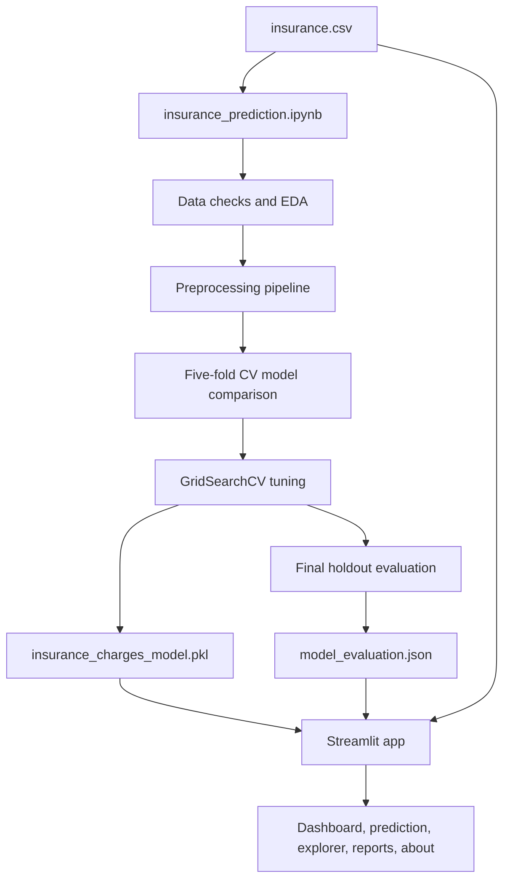

# Insurance Charges Prediction

An end-to-end regression project for exploring medical insurance charges, training and comparing models, interpreting predictions, and serving estimates through a Streamlit application.

**Live application:** [Insurance Charges Prediction](https://insurancecharges-prediction.streamlit.app/)  
**Repository:** [Kaviya-07/Insurance_Charges_Prediction](https://github.com/Kaviya-07/Insurance_Charges_Prediction)

## Overview and problem statement

Insurance charges vary across customer profiles. This project frames charge estimation as supervised regression: given demographic and lifestyle attributes, estimate the continuous `charges` target. The work demonstrates data inspection, exploratory analysis, preprocessing, model comparison, evaluation, feature interpretation, and deployment in one project.

## Objectives

- Understand and clean a real-world insurance dataset.
- Explore distributions, outliers, relationships, and correlations.
- Build a preprocessing and regression pipeline.
- Compare trained regressors using cross-validation.
- Keep a separate test partition for final evaluation.
- Explain model results and limitations.
- Provide interactive analysis, prediction, and report downloads.

## Dataset

`insurance.csv` contains 1,338 source records. The notebook finds and removes one duplicate, leaving 1,337 records for modeling.

| Feature | Description | Type / role |
| --- | --- | --- |
| `age` | Age of the primary beneficiary | Numerical input |
| `sex` | Recorded sex category | Categorical input |
| `bmi` | Body Mass Index | Numerical input |
| `children` | Number of covered dependents | Numerical input |
| `smoker` | Smoking status | Categorical input |
| `region` | Residential region | Categorical input |
| `charges` | Individual medical costs billed | Numerical target |

The notebook checks missing values and duplicates. Numerical inputs are median-imputed and scaled; categorical inputs are most-frequent-imputed and one-hot encoded within a scikit-learn pipeline. This dataset has no missing values in the current copy.

## Exploratory data analysis

The notebook and Executive Dashboard examine numerical distributions, categorical counts, outliers, numerical correlations, and charges by smoking status, age, BMI, region, and number of children. The dashboard includes interactive filters and downloadable filtered data.

## Modeling and validation

The notebook uses a fixed-seed 80:20 train/test split stratified by smoker status. Model comparison uses shuffled five-fold cross-validation on the training partition. The best candidate is selected by mean CV R-squared, tuned with GridSearchCV using only training data, then evaluated once on the held-out test partition. The test partition does not determine the model choice.

Preprocessing is fitted inside each cross-validation fold through a `Pipeline` and `ColumnTransformer`, avoiding leakage from imputers, scaling, or category encoding. Random seeds are fixed for repeatability. The notebook compares these models when available:

- Linear Regression
- Ridge Regression
- Lasso Regression
- Decision Tree Regressor
- Random Forest Regressor
- Gradient Boosting Regressor
- XGBoost Regressor (optional; included only when XGBoost is installed)

Only algorithms trained in the latest notebook run appear in the saved comparison and the app.

## Current model comparison

These are five-fold cross-validation means from the training partition in the latest run. MSE is in squared charge units; MAE and RMSE use the charge units.

| Model | CV R-squared | CV MAE | CV MSE | CV RMSE |
| --- | ---: | ---: | ---: | ---: |
| Gradient Boosting | 0.8395 | $2,774.48 | 23,102,217.76 | $4,760.34 |
| Random Forest | 0.8204 | $2,845.68 | 25,435,021.81 | $4,999.48 |
| Ridge Regression | 0.7225 | $4,398.39 | 40,049,867.89 | $6,297.01 |
| Lasso Regression | 0.7224 | $4,392.59 | 40,049,022.45 | $6,297.11 |
| Linear Regression | 0.7224 | $4,392.59 | 40,049,046.16 | $6,297.12 |
| Decision Tree | 0.6718 | $3,223.15 | 45,416,859.99 | $6,674.32 |

In the current run, Gradient Boosting ranked first by mean CV R-squared. GridSearchCV selected 100 estimators, learning rate 0.05, and max depth 3. The comparison and metrics are generated by `insurance_prediction.ipynb` and saved to `model_evaluation.json`; the app reads this file instead of hardcoding scores.

## Holdout evaluation

The selected model was evaluated on 268 records that were not used for selection or tuning:

| Metric | Result | Direction |
| --- | ---: | --- |
| R-squared | 0.9195 | Higher is better; 1 is ideal, and scores may be negative |
| MAE | $2,121.87 | Lower is better; average absolute error |
| MSE | 11,610,075.15 | Lower is better; squared error penalizes larger misses more |
| RMSE | $3,407.36 | Lower is better; error in the original charge units |
| Bootstrap 95% interval for MAE | $1,831.59 to $2,455.14 | Resampling interval on holdout absolute errors |

These values are tied to the included data, fixed seed, and current split. They are a benchmark, not a guarantee of performance on new customers or populations.

## Feature importance

The selected Gradient Boosting model uses its native tree feature importance. One-hot encoded category importances are aggregated back to their original fields. The latest calculated values are:

| Feature | Importance |
| --- | ---: |
| smoker | 0.6919 |
| bmi | 0.1809 |
| age | 0.1131 |
| children | 0.0107 |
| region | 0.0026 |
| sex | 0.0008 |

Importance represents predictive contribution or association in this fitted model; it does not show that a feature causes charges. The app’s chart uses values saved from the trained pipeline and run data.

## Streamlit application

The app preserves five pages:

- **Executive Dashboard:** filters, KPI summaries, interactive charge analysis, and CSV export.
- **Insurance Prediction:** validated customer inputs, estimates, prediction history, and Excel export.
- **Dataset Explorer:** filters, descriptive statistics, data types, missing values, and downloads.
- **Reports & Downloads:** summary, category, regional, and prediction-history reports.
- **About Project:** project and dataset information, live model metrics, cross-validation comparison, feature importance, and prediction limitations.

A centered, non-blocking tour card navigates to each of the five pages and explains its purpose on a new app session. The sidebar remains usable while the tour is open, and manual navigation updates the explanation. Users can skip it immediately or at any tour step.

The layout adapts to desktop, tablet, and mobile screens. Mobile styling stacks columns, keeps charts and tables within the viewport, expands download buttons, and restores the native sidebar controls for the navigation drawer.

## Project architecture



### Folder structure

```text
Insurance_Charges_Prediction/
├── app.py
├── insurance.csv
├── insurance_prediction.ipynb
├── insurance_charges_model.pkl
├── model_evaluation.json
├── requirements.txt
├── requirements-training.txt
└── README.md
```

## Installation and local run

Use Python 3.10 or newer. From the project root:

```bash
python -m venv .venv
# Windows PowerShell:
.venv\Scripts\Activate.ps1
# macOS/Linux:
# source .venv/bin/activate
pip install -r requirements.txt
```

Run the app:

```bash
streamlit run app.py
```

To retrain and refresh the model and evaluation artifact, install the notebook dependencies and run all notebook cells:

```bash
pip install -r requirements-training.txt
jupyter notebook insurance_prediction.ipynb
```

The notebook writes `insurance_charges_model.pkl` and `model_evaluation.json` into the project root. Run it before starting the app if either file is missing or after changing the data/model workflow.

## Deployment

The project is deployed on Streamlit Community Cloud at the live-app link above. Configure the GitHub repository with `app.py` as the entry point and install `requirements.txt`. Keep `insurance.csv`, `insurance_charges_model.pkl`, and `model_evaluation.json` in the deployed project root. The committed model is a scikit-learn Gradient Boosting pipeline, so the app and training artifact use the same preprocessing pipeline. If a future notebook run selects XGBoost, add `xgboost` to deployment dependencies before deploying that new model artifact.

## Screenshots

Screenshots are not included in this repository yet. Add captured app screenshots to `screenshots/` and replace these placeholders:

- `[Executive Dashboard screenshot: screenshots/dashboard.png]`
- `[Prediction page screenshot: screenshots/prediction.png]`
- `[Model evaluation screenshot: screenshots/model-evaluation.png]`

## Prediction limitations and responsible use

- Predictions are estimates, not actual insurance quotations.
- Results depend on a small, simplified dataset and may not generalize to other populations, regions, or time periods.
- Real insurance pricing may consider additional variables that are not present here.
- Correlation and feature importance do not imply causation.
- Profiles outside the training data's observed ranges may receive less reliable estimates.
- This educational project is not a substitute for professional insurance advice or underwriting review.
- Any real deployment would require broader validation, privacy safeguards, and fairness and regulatory review.

## Future improvements

- Add repeated or nested cross-validation and external validation data.
- Study subgroup errors and model calibration.
- Add prediction intervals to the interactive prediction flow.
- Track model versions, data drift, and retraining history.
- Add maintained screenshots and a model card describing intended use.
